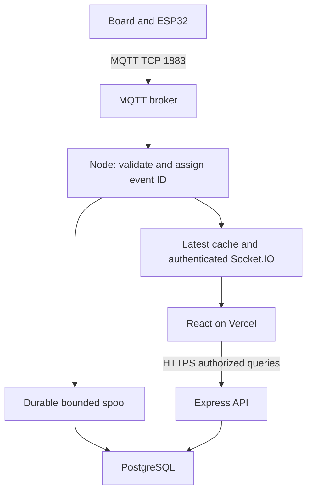

# Architecture
Single TypeScript workspace; one always-on Node web service owns MQTT ingestion, Express API and Socket.IO. PostgreSQL owns durable history, accounts and configuration. React/Vite on Vercel owns presentation only. A persistent local append-only spool is an outage buffer, not a replacement database.



## Decisions and alternatives
| Decision | Reason / tradeoff |
|---|---|
| React + TypeScript + Vite, CSS variables + Tailwind | Static deploy, typed components and one token system; no SSR needed for private operational screens. |
| Node 24 LTS, npm workspaces and committed lockfile | One runtime and package manager; select exact patched versions in Phase 1 and run compatibility checks. Legacy version ranges are not an approved lockfile. |
| Express + MQTT.js + Socket.IO | Fits required path and existing skills. Socket.IO reconnect is useful but delivery is not durable by default; application resync remains mandatory. |
| Zod schemas in packages/contracts; pure parser in packages/protocol | Validate runtime payloads at API/socket boundaries as well as compile time. No credentials or server-only modules exported to web. |
| PostgreSQL + Drizzle migrations + pg pool | Explicit SQL/index control with typed queries. Decimal counters survive JavaScript rounding; use decimal arithmetic for reporting. |
| One Node process/instance initially | Avoid duplicate subscriptions and distributed ordering. More instances require redesigned MQTT ownership, shared cache/bus, socket adapter and auth invalidation; do not enable autoscaling casually. |
| Append-only fsync spool on persistent disk | DB downtime need not stop live cache. Disk capacity and recovery are finite; disk-backed deploys have interruption tradeoffs. |
| Local shared React store + useSyncExternalStore; TanStack Query for HTTP | Keep frequent telemetry updates out of whole-app React state; cache history separately by site/device/time/config version. |
| Recharts lazy-loaded, linear segments, no interpolation over gaps | Familiar maintainable charting; maximum 600 visible points per series and resize debouncing protect mobile. |
| Server sessions with opaque short access tokens | Simple revocation and role checks. No hardcoded browser auth or persistent bearer tokens in localStorage. |

## Repository contract
```text
apps/server/src/{config,auth,api,mqtt,ingest,realtime,storage,alerts,reports,observability}/
apps/web/src/{app,auth,live,pages,components,styles}/
packages/contracts/src/       # runtime API/socket schemas
packages/protocol/src/        # pure legacy packet parser
packages/db/{src,migrations}/
tests/{fixtures,integration,e2e,hardware}/
scripts/                     # isolated test publisher, load runner, evidence tooling
infra/{compose.test.yml,render.yaml,vercel.json}
docs/                        # this contract and verification evidence
progress.md
package.json                 # workspaces and root check commands
```

## Ingestion and persistence ordering
At callback entry capture wall-clock UTC and monotonic receipt time. Parse, authorize registered source/device, assign UUID/event cursor, update latest cache immediately, enqueue an immutable record for spool append and emit authorized telemetry with persistence=pending. Concurrent history/UI must not imply pending means committed. Group append and fsync at ≤100ms or 100 records; commit DB batches ≤250ms or 100 records (whichever first). Emit a persistence watermark/receipt after DB transaction commits. Live ingestion never waits for a history query.

Spool starts before MQTT subscription, uses checksummed length-delimited records and segment rotation. Fsync makes an event durable locally; DB transaction inserts sample ON CONFLICT eventId DO NOTHING, updates latest conditionally, and records consumer progress. Delete/compact spool segments only after all events are committed. Recover and truncate only an incomplete final record; quarantine checksum corruption and alarm. Concurrent writer/reader operations are serialized. Persist eventId, receivedAt and cursor unchanged through replay. Latest hydration must compare receipt time/cursor so replay never overwrites a newer cache reading.

Bound RAM queue to 10,000 records and spool to 1GiB initially; tune from measured rate/bytes. Expose queue age/bytes/depth and durability status. At 80% disk quota alert. On disk full/IO failure stop claiming durable ingest; attempt DB direct commit when healthy, otherwise mark events non-durable and increment explicit loss counters. Keep live updates if safe, but mark report windows incomplete. Do not block the event loop or allocate unbounded queues. Process crash can lose pre-fsync events (target ≤100ms normal operation), and broker/backend downtime can lose QoS0 or clean-session messages. Record limitations instead of promising lossless telemetry.

On SIGTERM stop accepting new configuration writes, end MQTT subscription, drain queue with bounded deadline, fsync, close DB/socket, log unflushed count. On startup recover spool, load configuration and last known committed samples before subscribing. If DB is unavailable at cold start, ingestion stays unready until authorized configuration is loaded; no unauthenticated data access. Existing authenticated sessions during DB outage may read live for at most 60s using cached grants, then fail closed. No login or mutations without DB.

## Versioned contracts
All events carry schemaVersion=1; UUIDs as strings, timestamps ISO UTC, sequences as decimal strings to avoid safe-integer overflow. Telemetry payload:
`{eventId,serverEpoch,sequence,siteId,deviceId,channelId,receivedAt,deviceTimestamp:null,values:{voltage,current,power,energyRaw,frequency},energyUnit,quality:[],retained,persistence}`.
EnergyRaw is a decimal string; live scalar values are finite numbers. Raw payload is excluded from routine client events. Strict schemas reject unknown event versions and trigger compatible-error UI, not silent corruption.

Snapshot: `{schemaVersion,requestId,selectionGeneration,serverEpoch,cursor,serverNow,siteId,deviceId,mappingVersion,channels:[{rawChannelId,displaySlot,label,lastSample:null|Telemetry,lastReceivedAt,freshness}],health,coverage}`. Include all five display slots, null for unconfigured/unseen, never zeros. Health separates process reachability, broker transport, subscription, DB and persistence lag. Client owns socket transport state.

Client emits `device:subscribe {requestId,selectionGeneration,siteId,deviceId}`. Server verifies membership and authorized device, joins selected-device room and serializes capture of cache/cursor plus snapshot enqueue with ingestion (no await inside that critical section). Queue subsequent deltas behind snapshot for that socket. Acknowledge selection and send `state:snapshot` immediately. Client buffers deltas until snapshot for matching generation, then applies sequence greater than cursor. Ignore late replies from previous device selection. On reconnect or epoch change discard cursor assumption and request fresh snapshot; refill chart window from history using overlap/eventId dedupe. On any detected gap, reconcile rather than pretending delivery is complete.

Other events: `telemetry:update`, `system:status` (heartbeat every 5s and on transition), `persistence:watermark`, `alert:changed`, `config:changed`, `auth:expired`, `resync:required`. Socket reconnect backoff 1–30s with jitter. Status heartbeat expiry 15s makes upstream state unknown. Reserve acknowledgements with timeout for subscription/config operations; telemetry uses bounded buffers and resync under backpressure. Coalesce slow-client pending updates by composite channel key, declare resync required and preserve full history server-side. Do not replay an unbounded event queue to a slow phone.

## HTTP endpoints
All `/api/v1` data routes authenticate and enforce site/device ownership; schema validation, parameterized SQL, structured `{error:{code,message,requestId}}` failures. HTTP status 400 invalid, 401 unauthenticated, 403 denied, 409 version conflict, 422 billing not validated, 429 rate-limited, 503 dependency unavailable.

| Method/path | Contract |
|---|---|
| POST /auth/login, /auth/refresh, /auth/logout | Credential/session lifecycle; generic failures, rotation, logout revocation. |
| GET /me; PATCH /me | Profile and allowed preferences only. |
| GET /sites; GET /sites/:s/devices | Assigned resources; no client-supplied grant accepted. |
| GET /devices/:d/snapshot | Authorized HTTP fallback snapshot with same schema, not a separate truth source. |
| GET /devices/:d/history | from/to UTC, rawChannelIds, metric, resolution auto/raw/1m/1h; half-open [from,to), cursor pagination and quality/coverage. |
| GET /devices/:d/export.csv | Same filters and frozen cutoff; stream max 100,000 rows or return range-too-large. |
| GET /devices/:d/reports | day/month, local date, IANA timezone, report configuration version and coverage. |
| GET /alerts; POST /alerts/:id/ack | Scoped pagination, idempotent acknowledgement; server captures actor/time. |
| GET/PATCH /devices/:d/config | Admin, expectedVersion optimistic lock, audit before/after, push invalidation. |
| GET /diagnostics | Admin details; operators receive sanitized service state. |
| GET /health/live; /health/ready | Public minimal process/config readiness, no broker credentials or telemetry. DB/broker degradation separately observed; do not restart-loop a healthy ingestor just for DB outage. |

History max raw window 24h, max 2,000 API points per series, default cursor limit 500 and hard limit 2,000. Long windows use real aggregates with count/min/max/coverage, never artificial smooth curves. Exports use a read transaction/frozen cutoff so pagination does not race new arrivals.

## Authentication and trust boundaries
Admin creates invited users; password hashes use maintained Argon2id implementation with calibrated cost. Login returns a short-lived opaque access token (5 minutes) held only in memory. Hash tokens at rest; DB-backed session tracks expiry/revocation/membership. Refresh token rotates in HttpOnly Secure cookie; reuse revokes token family. Socket handshake sends access token via auth object, never URL query. Expiry timer disconnects; refreshing token reconnects and resyncs. Revoke all sockets for logout/user disable; authorize every room join and write even after handshake.

Prefer app.company-domain and api.company-domain (Vercel/Render custom domains under the same registrable domain), host-only API cookie, SameSite=Lax, no Domain widening. Validate Origin on login/refresh/mutations and use CSRF token on cookie-authenticated refresh/logout. Exact credentialed CORS allowlist, separate staging origins, no wildcard preview domains. Default vercel.app/onrender.com origins are cross-site; if browser blocks refresh cookies, offer explicit re-login on expiry/refresh. Do not solve it by persisting tokens in localStorage. Company-domain cookie behavior must be tested on iPhone and Android. Refresh on reload restores the session when cookie policy allows; otherwise clear sign-in state truthfully.

Read-only broker subscriber credentials, environment-configured secrets, safe log redaction, CSP, clickjacking protection and rate limits. Source namespaces and broker ACLs govern trusted device provisioning: knowing a device string is not hardware authentication. Current shared topic cannot independently authenticate individual boards; record this limitation.

## Failure semantics
| Failure | User-visible state | Recovery |
|---|---|---|
| Valid zero power/current | Fresh · zero load | No connectivity alarm |
| Channel silence with live upstream | Stale then “Not reporting (offline inferred)” | First fresh non-retained packet resets receipt freshness |
| Broker disconnected/subscription failed | Broker unavailable; hardware state unknown | Backoff, SUBACK, live packets; retain last values visibly stale |
| Socket down, backend HTTP reachable | Live stream disconnected | Reauthenticate/resync; do not mark hardware off |
| Backend health requests fail | Backend unreachable from this browser | Independent low-rate backoff probe; cannot prove server globally down |
| DB down, warm process | Live available; history saving delayed | Durable spool replay; no invented report completeness |
| Backend restart | Reconnecting; last committed values | New epoch and snapshot; never reset persisted history |
| Network slow/tab hidden | Catching up; stale age advances | Bounded buffer and snapshot; measure separately |

Browser HTTP health probe is only used on socket failure (5s increasing to 30s), not repeated telemetry polling. Never label upstream outages as electrical faults.
