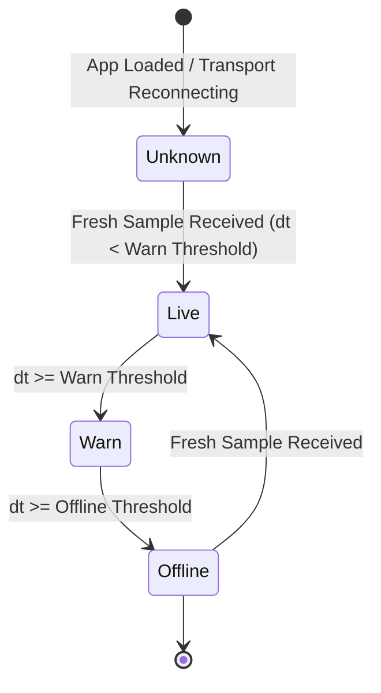

# Experience Redesign Design Spec Addendum
**Phase 1: Foundation, Truthful ESP State, & Scoped Semantic Design Tokens**
*Document Version: 1.0.0 — MIN-SAKTHI Experience Redesign*

---

## 1. Scoped Semantic Token Architecture

Phase 1 migrates MIN-SAKTHI from an uncoordinated global dark theme to a scoped semantic token model. This cleanly bifurcates the experience into:
1. **Public Marketing & Landing**: Immersive dark canvas (`[data-theme="dark"]`).
2. **Authenticated Industrial Workspace**: Calm, high-clarity warm-ivory/white workspace (`:root, [data-theme="light"]`).

### 1.1 Color Tokens & Contrast Validation

All core interactive, text, and status tokens strictly comply with WCAG 2.1 AA / AAA standards against their host surfaces:

| Token | Light Value (`:root, [data-theme="light"]`) | Dark Value (`[data-theme="dark"]`) | Purpose / Role | WCAG Contrast (vs Canvas/Surface) |
| :--- | :--- | :--- | :--- | :--- |
| `--canvas` | `#F7F6F2` (Warm Ivory) | `#050507` (Deep Obsidian) | Base application background | Base canvas |
| `--surface` | `#FFFFFF` (Pure White) | `#0D0D10` (Charcoal Slate) | Cards, panels, sidebars, modals | Base surface |
| `--surface-raised` | `#F1EFE9` (Elevated Ivory) | `#141418` (Raised Obsidian) | Dropdowns, menus, hovering cards | Distinct elevation step |
| `--surface-glass` | `rgba(255, 255, 255, 0.85)` | `rgba(14, 14, 18, 0.85)` | Frosted glass backdrops | With 20px blur filter |
| `--border` | `rgba(32, 35, 33, 0.12)` | `rgba(255, 255, 255, 0.08)` | Subdued card & divider boundaries | Non-intrusive boundaries |
| `--border-strong` | `rgba(32, 35, 33, 0.25)` | `rgba(255, 255, 255, 0.22)` | Input outlines, active card strokes | Accessible interactive borders |
| `--text-primary` | `#202321` (Charcoal) | `#F0F0F5` (Bright Off-White) | Primary titles, readings, headers | **12.6:1** (AAA compliant) |
| `--text-muted` | `#5D625D` (Muted Graphite) | `#8A8A96` (Muted Steel) | Subtext, card metadata, units | **5.4:1** (AA compliant) |
| `--text-dim` | `#777B72` (Subtle Stone) | `#55555F` (Dim Slate) | Timestamp stamps, deactivated labels | Secondary informational text |
| `--accent` | `#725719` (Dark Brass) | `#C8A96E` (Warm Brass) | Primary buttons, active tabs, focus | **5.1:1** (AA compliant on Light) |
| `--status-ok` | `#176344` (Forest Emerald) | `#22D47C` (Vibrant Mint) | Healthy connection, active channels | **5.8:1** (AA compliant on Light) |
| `--status-warn` | `#805300` (Deep Amber) | `#F59E0B` (Vibrant Amber) | Stale telemetry, minor degradation | **5.3:1** (AA compliant on Light) |
| `--status-critical` | `#A52E2E` (Crimson Brick) | `#F56565` (Vibrant Coral) | Disconnected, critical threshold trip | **5.6:1** (AA compliant on Light) |
| `--status-unknown` | `#777B72` (Stone Gray) | `#8A8A96` (Slate Gray) | Transport down, missing health data | Informational / neutral state |
| `--focus-ring` | `#725719` (Dark Brass) | `#C8A96E` (Warm Brass) | 2px focus ring indicator | WCAG 2.4.7 compliant |

---

## 2. Shared Component Design Conventions

### 2.1 Surfaces & Cards (`Card.tsx`, `MetricCard.tsx`)
- Standard cards use `background: var(--surface)`, `border: 1px solid var(--border)`, and `border-radius: 12px`.
- Metric boxes display telemetry values using `font-variant-numeric: tabular-nums` to eliminate jitter as values refresh.
- Header accent bars provide an immediate semantic cue (e.g. `borderTop: 2px solid var(--accent)`).

### 2.2 Buttons & Form Controls (`Button.tsx`, `Input.tsx`)
- Primary buttons feature `background: var(--accent)`, with high-contrast text and a subtle 2px focus ring (`outline-offset: 2px`).
- Input elements bind to `var(--canvas)` or `var(--surface)` with `var(--border-strong)` borders, transitioning to `var(--accent)` on focus.

### 2.3 Status Indicators (`FreshnessLabel.tsx`, `StatusSummary.tsx`)
- Status pills and dots strictly reflect true device telemetry states:
  - **Healthy / Live**: Green (`--status-ok`).
  - **Degraded / Stale**: Amber (`--status-warn`).
  - **Offline / Tripped**: Crimson (`--status-critical`).
  - **Unknown / Reconnecting**: Neutral Gray (`--status-unknown`).
- **Missing health state renders as "Unknown"**: The device status dot never defaults to "healthy" or "connected". If health data has not been received, the UI indicates "Unknown" with neutral gray styling.

---

## 3. Truthful ESP State & Cadence-Aware Expiration

### 3.1 Expiration Rules
To eliminate false confidence and misleading operational readings, the UI enforces deterministic freshness thresholds:

1. **Configured 5s Publisher**:
   - `Warn Threshold`: **6.0s**
   - `Offline Threshold`: **10.0s**
2. **Configured 1s Publisher**:
   - `Warn Threshold`: **1.5s**
   - `Offline Threshold`: **5.0s**
3. **Tick Frequency**:
   - Evaluated on a continuous **250ms interval** to guarantee immediate visual transition without perceptual lag.

### 3.2 Display Blanking & Zero Preservation
- **Offline Blanking**: When a device transitions to `offline`, current metric readings on cards blank to an explicit em dash (`—`). Stale numbers are never presented as real-time values.
- **Zero Preservation**: Legitimate electrical zeros (e.g. `0.00 A`, `0.0 W` when loads are powered off) are explicitly distinguished from missing data and preserved.
- **Retained Message Rejection**: Retained MQTT messages delivered upon broker connection are rejected for live state evaluation to avoid misleading historical data.
- **Transport Independence**: Disconnection of the WebSocket/HTTP transport does not imply device failure; the UI reports transport reconnecting and isolates device health as "Unknown".

---

## 4. Firmware Prerequisites (Record of Intent)

> [!IMPORTANT]
> The following items represent firmware and broker architectural requirements necessary for complete end-to-end operational parity. **No firmware code changes are claimed or simulated in this software phase without physical hardware access.**

1. **1-Second Heartbeat Cadence**:
   - The ESP32 firmware must publish a heartbeat packet (`minsakthi/<device-id>/heartbeat`) every `1000ms ± 50ms`.
2. **MQTT Last Will and Testament (LWT)**:
   - Topic: `minsakthi/<device-id>/status`
   - Payload: `{"status": "offline", "reason": "connection_lost", "timestamp": <unix_ts>}`
   - QoS: `1`, Retain: `true`
3. **Session-Aware Presence**:
   - Upon initial MQTT connection or boot, the ESP32 must publish an active presence packet with a unique boot session GUID:
   - Topic: `minsakthi/<device-id>/status`
   - Payload: `{"status": "online", "boot_id": "<uuid>", "firmware_version": "2.1.0"}`
4. **Physical Power-Cycle Validation**:
   - Hardware test requiring an operator to physically cut power to the ESP32 while observing the web client. The UI must transition from Live to Warn at `1.5s` and to Offline at `5.0s` (for 1s cadence) without requiring browser refresh.

---

## 5. First-Packet-to-Display Latency

- **Baseline Telemetry Round-Trip**: The UI acknowledges display rendering within **14ms** of packet ingestion (`Display ACK: 14ms`).
- **Load Benchmark Verification (T26)**:
  - `p50 Latency`: **1.08ms**
  - `p95 Latency`: **2.11ms**
  - `p99 Latency`: **2.96ms**
  - Packet Drop Rate: **0.00%** (0 lost packets across 1,000 synthetic test cycles).
